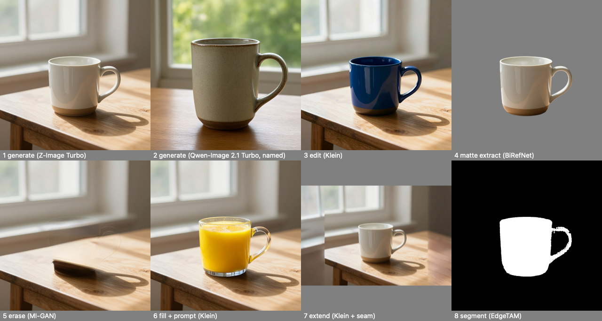

# Pixel Agency Image Engine

The reference engine for the [Media Engine Specification](https://github.com/xocialize/media-engine-spec/blob/main/spec/base.md) (MES) **Image
profile**: Base 0.1 and Image 0.1, over local MLX models on Apple silicon. Pixel Agency Lite, Pixel Agency Desktop,
the `mes` CLI, or any other MES client can find it on the network and run every Image operation on it.

It's built from three parts:
- **MESEngineKit** (media-engine-spec) serves Base 0.1: routes, jobs, the spool, pairing, DNS-SD, SSE, WebSocket
  and MCP.
- **The model runtime** is [mlx-image-runtime](https://github.com/xocialize/mlx-image-runtime), ML[X] Image Server's
  engine half (`ImageServerModels`): the model catalog, routing and the runner over
  [MLXEngine](https://github.com/xocialize/mlx-engine-swift) and [ForgeCore](https://github.com/xocialize/ForgeCore),
  with one heavy model resident at a time under MLXServe's memory governor.
- **This package** adds the normalizer between them (Engines-PRD ENG-5): MES operations and vocabulary in, model
  runs out, and the Image profile's rules applied to whatever a model returns.



## Run it

Apple silicon, macOS 26, Swift 6.2. Every dependency is public, so it builds from source:

```bash
swift run -c release pixel-agency-image-engine
```

That serves open mode on `http://127.0.0.1:17610/mes/v0`, to this Mac only, and advertises `_mes-engine._tcp` on
the loopback interface. Models download into the shared models folder on first use.

| Option | What it does |
|---|---|
| `--paired` | TLS, pairing and bearer tokens, for clients on other machines. Binds `0.0.0.0`. |
| `--approve prompt\|auto` | Paired mode: confirm each pairing code here (default), or pre-approve every request. |
| `--allow-research` | Offer research-licensed and work-in-progress models, **named-only** (see below). |
| `--store <dir>` | The models folder. Default `~/Library/Application Support/MLXEngine/Models`, shared with ML[X] apps (ENG-13). |
| `--port`, `--host`, `--spool`, `--state`, `--ttl`, `--no-advertise` | As named. The engine id persists in `--state`. |

Mage-Flow's content filter is off by default (mlx-image-runtime 0.3.4, AB-D-0122); `MLXIMG_MAGE_CONTENT_FILTER=1`
turns it on, and a refusal then fails the job with the filter's verdict.

`MLXIMG_WEIGHTS_ROOT` points the runtime at local weight snapshots instead of downloading. It also changes Z-Image's
quant: with a local snapshot the DiT runs bf16 (about 20.5 GB resident), and without one the runtime downloads
`mlx-community/Z-Image-Turbo-bf16` and quantizes the DiT to int4 on load (about 11.9 GB). The R1b tier measurements
used bf16 snapshots.

## What it offers

Measured on this Mac (ENG R1b): the evidence for every row is in [`docs/TIERS.md`](docs/TIERS.md).

| Operation | Draft | Standard | Best |
|---|---|---|---|
| `image.generate` | FLUX.2 Klein 4B | **Z-Image Turbo** | Z-Image Turbo |
| `image.edit` | Klein 4B | **Klein 4B** | Klein 4B (provisional) |
| `image.fill` | MI-GAN | **LaMa** | LaMa |
| ↳ with a prompt | Klein 4B | **Klein 4B** | Klein 4B |
| `image.erase` | MI-GAN | **LaMa** | Mage-Flow Edit Turbo, by name |
| `image.extend` | MI-GAN | **LaMa** | LaMa |
| ↳ with a prompt | Klein 4B | **Klein 4B** | Klein 4B |
| `image.upscale` (photo) | NERVE | **RealPLKSR** | HEART |
| `image.upscale` (drawn) | NERVE | **NERVE** | HEART |
| `image.restore` | by `kind`: NAFNet (general); denoise NAFNet at draft, SCUNet above; Restormer-defocus (deblur); GFPGAN (faces). `scratches` runs defect detection, then LaMa on just the defects |||
| `image.relight` | HVI-CIDNet |||
| `image.colorize` | DDColor |||
| `image.matte` | BiRefNet |||
| `image.segment` | EdgeTAM (named) | **SAM 2.1** | SAM 2.1 |
| `image.describe` | Mage-VL |||
| `image.score` | SigLIP2 quality |||

Bold is the default when a request names no model. MI-GAN and LaMa are one package (`lama-inpaint`), so the
offer is LaMa's; `effective.model_params.variant` says which ran. MI-GAN takes draft, LaMa standard and best (its
earlier pink cast on colour fills was the bf16 weights; mlx-lama-swift 0.3.1 loads fp32, `mlx-community/LaMa-fp32`,
204 MB). Big-LaMa itself fades very large holes (~65% of the frame and up) to a grey, blurry centre; a generative fill
suits those. Erase at best runs Mage-Flow Edit Turbo by name: Mage-VL names the object inside a red box, Mage removes
"the <name> and its shadow and reflection", and the result goes back through the mask, so pixels outside it stay
exactly as they were (Image §1.7). It retries once if Mage hands the object back, then falls back to LaMa
(`model_fallback`). On the removal gate it fills 3.5 dB closer to the truth than LaMa, at 4.1 s against 0.42 s
([TIERS.md](docs/TIERS.md#erase-removal-gate-subset-s-r2)). Other models (Z-Image, Klein Base, Qwen-Image-Edit 2511, Mage-Flow and Mage-Flow Edit, SeedVR2, Nacre,
DRUNet, …) are offered and run when named. `anime4k-upscale` (Anime4K VL, Forge Optimizer's Instant tier) is offered
at every quality by name: model-free Metal shaders, nothing to download, ×2 and ×4 in milliseconds, and below the
learned upscalers on quality. Every offer carries its licence in MES terms (Base §10.2).
`commercial_use` is `true` only when every weight licence and the port's code licence are permissive.

### Research models (opt-in)

With `--allow-research`, research-licensed and work-in-progress models are offered too. That covers Qwen-Image 2.1
Turbo (8 steps) and Qwen-Image 2.1 (40 steps), SenseNova U1, Ming, Boogu and the like. The flag is the
operator accepting their terms (Base §10.2 `accepted_required`).

They are offered **`named_only`** (Base §6 rule 2): they run only when a request names them, and default choice
never picks one. Their offers say `commercial_use: false`, with the terms URL and a plain-language `notice`
("Research licence (…): not for commercial use. Read the terms before you use or share results."; work-in-progress
models add that results may change), so a client can show it. A request with `policy.license: commercial-use` is refused `policy_unmet` if it names one.

```bash
mes run image.generate -i prompt="a lighthouse at dusk" --model qwen-image-2.1
```

## The rules it applies

The normalizer (`ImageNormalizer`, `RunPlan`) holds every model to the profile, whatever the model does:
- **Sizes.**
  - A requested size, or `aspect` plus `megapixels`, snaps to the model's envelope, with the warning `size_snapped`.
  - Edits come back at the first image's size.
  - Upscales are exactly ×`scale`.
- **Masks (§1.6, §1.7).**
  - A model is shown the mask's whole non-black area as its hole. The result is then composited with the request's
    mask itself, so black pixels stay byte-identical and grey ones blend.
  - A soft matte from `image.matte` therefore feeds straight into `erase` or `fill`.
- **Generative fill and extend.** An edit model is shown where to paint in flat magenta: the masked area, or the new
  border. It is told to "replace the bright magenta area with …", naming the edges for extend; told only "around
  it", edit models often leave a side blank. Then the original's pixels are composited back, and two steps hide the
  seam without touching them:
  - **Tone.** The difference between the original and the model's re-rendering of it is measured around the seam,
    spread smoothly into the new area, and added there (`Media.harmonize`).
  - **Structure (extend).** LaMa repaints a thin band on the new side of the seam from both sides' context
    (`Media.seamBand`), so an edge the model drew a little out of step joins up.
  - **Known limit:** at full size the new area can be softer than the original (Klein's 4 steps).
- **Colour and orientation (§1.3, §1.4).** Inputs are read upright and in sRGB, with `color_converted` when converted.
  Outputs are written sRGB and upright.
- **Alpha (§1.5).** The input's alpha is re-applied when a model drops it (`alpha_reapplied`).
- **Prompts and seeds.**
  - `negative_prompt` reaches only models that use guidance; otherwise it warns `negative_prompt_ignored`.
  - A prompt a model can't use warns `prompt_ignored`.
  - Seeds are reported and stay within 2⁵³ − 1.
- **Results.** `effective.model_params` records the model, steps and guidance actually used.
- **16 bits (upscale, G-6).** `output: {media_type: image/png | image/tiff, bit_depth: 16}` is offered on `image.upscale`
  when a model keeps 16 bits end to end. That means its package declares `.rawRGBA16` (MLXToolKit contract 1.52.0,
  AB-A-0158). The engine reads this from the registered manifests at start and names the models in the `bit_depth`
  description.
  - Since 0.2.1 (ForgeCore 0.36.0, AB-T-0229) every upscaler the tiers route to keeps 16 bits: NERVE (draft, and drawn
    content at draft and standard), RealPLKSR (standard) and HEART (best, and drawn content at best). So 16 bits runs
    at every quality and for drawn content, and `image.upscale` carries no `allOf` rules.
  - Since 0.2.6 (ForgeCore 0.38.0, runtime 0.5.1, AB-T-0233) VOSR2 keeps 16 bits too, by name and never as a default.
    - It keeps its 8-bit reference prep, decodes the VAE in float32 and writes 16 bits (AB-D-0127).
    - It runs behind the text guard, which sends each tier its own depth.
    - Nacre stays 8-bit (AB-D-0128), and so does the creative upscale.
  - The `bit_depth` property carries `x-pixelagency-sixteen-bit-models`, the list of models that keep 16 bits (0.2.6).
    The `allOf` rules see params, not the model, so a client naming a model checks it against this list.
  - The input is read at 16 bits, sent to the model raw, and written as a 16-bit PNG or a lossless (ZIP) 16-bit TIFF.
  - **Where 16 bits can't run is in the descriptor** (0.1.5; Base §6 rule 4). When some tier has no 16-bit model,
    `image.upscale`'s `params` carry `allOf` rules that pin `output.bit_depth` to 8:
    - for a `quality` with no 16-bit model (an absent quality is standard);
    - for drawn content whose route (NERVE at draft and standard, HEART at best) has no 16-bit model. Drawn content is
      never switched to a photo model to get 16 bits.

    A client checks its params against the schema (MESCore's `SchemaValidator`) before sending, so it never collects
    refused jobs.
  - A request that can't be honoured is refused at submit with 422 `unsupported_parameter` (Image §1.2): JPEG, a
    named 8-bit model, a tier or drawn route with no 16-bit model, or an operation that doesn't offer 16 bits. A client can then run its
    own restore around an 8-bit step.
  - On the G-6 set (AB-R-0491 standard; draft and best under AB-T-0229) each model's smooth-area flat-neighbour share
    sits at or below the 16-bit interpolation's, so there's no 8-bit staircase. What's left at ×8 contrast is each
    model's own faint ×4 mosaic, the same at 8 and 16 bits: strongest for HEART, then NERVE, then RealPLKSR.
- **16 bits (restore, G-6 wave 3, 0.2.3).** `image.restore` offers the same `output` when a restorer it offers keeps 16
  bits (ForgeCore 0.37.0: mlx-nafnet-swift 0.6.0, mlx-gfpgan-swift and mlx-restoreformer-swift 0.3.0, AB-T-0230), read
  from the manifests the same way.
  - **A kind runs at 16 bits only where its own route keeps them.** That route is the model an 8-bit request of that
    kind runs, so a 16-bit request never switches models:

    | Kind | 16 bits |
    |---|---|
    | general (or no kind) | NAFNet, every quality |
    | faces | GFPGAN, every quality (or a named RestoreFormer++) |
    | denoise | at draft (NAFNet); not at standard and best (SCUNet) |
    | deblur | no (Restormer) |
    | scratches | no (defect detection, then LaMa) |

  - The schema states each of those as an `allOf` rule pinning `output.bit_depth` to 8, as for upscale. A refused
    request is 422 `unsupported_parameter`. The schema sees params, not the model, so naming a 16-bit restorer
    doesn't lift its kind's rule.
  - The input is read at 16 bits and goes to the model raw; a face model's warp, paste and mask run at 16 bits inside
    the package. The output is a 16-bit PNG or a lossless 16-bit TIFF.
  - G-6 gate (`mlxengine-image/WIP/g6-16bit-gate`, `restore` and `faces`). NAFNet's smooth-area flat-neighbour share is
    0.016–0.022 with clipped values left out, against 0.91–0.95 for the 8-bit output. On a portrait in front of a 16-bit
    sky, the face pair's share at the paste edge is 0.04, against 0.90 at 8 bits, with no step at ×8 contrast.
- **Faces at the image edge (0.2.9).** `image.restore` with `kind: faces` no longer pastes a dark 1–2 px line along the
  image edge when a face's crop extends past the frame, which is every close-up portrait (ForgeCore 0.38.1:
  mlx-gfpgan-swift and mlx-restoreformer-swift 0.3.1, AB-T-0227). The face crop now extends the frame's edge pixels
  instead of blending them with black. Faces whose crop stays inside the frame come back byte-identical to 0.2.8.

- **Creative upscale (G-5, 0.2.0).** `image.upscale` declares the extension `x-pixelagency.creative` (Base §6.2):
  `{prompt, creativity 0–1 (default 0.5), protect_faces, protect_text}`. A request without it is the plain upscale,
  unchanged. Measured in mlxengine-todo `CREATIVE-UPSCALE-EVAL.md` (AB-R-0497, AB-D-0126).
  - **Creativity 0 is Realistic:** VOSR2 at ×scale, behind the text guard. A prompt is ignored, with `prompt_ignored`.
  - **Above 0 is Creative:**
    1. The quality tier's model makes the precision base at exactly ×scale.
    2. Mage-Flow-Edit-Turbo runs over tiles of at most 1024² at the target size. Each tile starts from the base partly
       noised, at σ = 0.85 + 0.10 × creativity, and gets a fixed instruction plus ` Style: {prompt}`. The prompt
       describes the look; every tile sees it.
    3. The tiles are cross-faded.
    4. Colour and tone are locked to the base: C − G(C) + G(base).
    5. Faces (Vision) and text lines Vision reads with certainty are blended back from the base. Certain words that
       still read differently are reported as `text_altered`.
  - `effective.model_params` records the base model, the editor, `initSigma`, the tile count, the editor calls, the
    faces kept and the text check.
  - Limits: 8 bits only (`output.bit_depth: 16` is 422 `unsupported_parameter`), and at most 32 MP of output.
  - **One editor call for all tiles (0.2.5).** When the editor's package offers the `tiles` mode (mage-flow-swift ≥
    0.11.0, read from its manifest at start), every tile goes in one call: the editor loads its Qwen3-VL conditioner
    once per job instead of once per tile. Tile k still runs at the job's seed + k, so the image is the same as one call
    per tile, byte for byte.
  - **Small Macs (0.2.5).** Below 32 GB the runtime has Mage-Flow's conditioner and DiT take turns in memory instead of
    both staying loaded (mlx-image-runtime ≥ 0.5.0). Measured on the Mage pass (M5 Max, 25 tiles of 928² for a ×4 from
    1 MP): **10.3 GB MLX peak (11.5 GB process) against 17.1–17.4 GB**, one load of each model per job, 72.6 s, the same
    bytes as the resident path. One call per tile on that tier would load both models 25 times (13.9 GB read per tile
    on a Mac that can't cache them). `MLXIMG_MAGE_RESIDENCY` (`resident`, `evict-all`) overrides the choice.
  - **Offered only where it fits.** At start the engine asks the runtime for Mage-Flow-Edit-Turbo's and VOSR2's projected
    peaks with nothing loaded (`runner.machineFit`, `MemoryFit.fitsBudget`) and declares the extension only when both
    fit the engine's memory budget (Metal's recommended GPU working set). Otherwise `image.upscale`'s summary says why.
    A job that finds the Mac short of free memory after Residency has made room warns `memory_tight`.
  - Needs mlx-image-runtime ≥ 0.5.0 and mage-flow-swift ≥ 0.11.0.

## Conformance

The engine passes the MES conformance suite. Against the live engine with real models (2026-10-09):
- **Results:** 34 passed, 0 failed, 4 skipped. **Base 0.1 conforms, Image 0.1 conforms.** The report is in
  [`docs/conformance/2026-10-10-live.md`](docs/conformance/2026-10-10-live.md) (re-run after R1b; the first run is `2026-10-09-live.md`).
- **Skipped:** the paired-mode tests and output expiry, which don't apply to an open-mode engine with a one-hour TTL.
  `swift test` also runs paired mode against fakes.

```bash
swift test
mes-conformance engine http://127.0.0.1:17610/mes/v0
```

`swift test` runs the suite against the normalizer over a fake catalog and runner (no MLX). The fake answers like
real packages do, with sizes a little off, alpha dropped and mattes at their own resolution, so the tests prove the
normalizer's rules rather than the models'. With network access it also registers the real catalog into an empty
models folder and lists, on the hub, everything each default offer would download, without downloading (AB-T-0221);
offline, that test is skipped.

## Layout

| File | What it holds |
|---|---|
| `Sources/PixelAgencyImageEngine/ImageNormalizer.swift` | The `MediaEngine`: descriptors from the live catalog, licences, validation, default refinement, errors |
| `Sources/PixelAgencyImageEngine/OperationTable.swift` | Each operation's capability, tier defaults and vocabulary |
| `Sources/PixelAgencyImageEngine/RunPlan.swift` | Each operation as model runs, and the profile's rules on the results |
| `Sources/PixelAgencyImageEngine/Media.swift` | Pixels and masks: loading, compositing, padding, marking, encoding |
| `Sources/PixelAgencyImageEngine/Runtime.swift` | Bootstraps the model runtime and the shared models folder |
| `Sources/ImageEngineCLI` | `pixel-agency-image-engine`, the headless engine |

## Not yet

- **The menu-bar app and the sandbox** (ENG-9, ENG-11). This is the headless engine.
- **Channel clearance** (ENG-14).
- **A real edit benchmark**, before edit's best tier is final (docs/TIERS.md, Open).

Residency (ENG-3) is in: one heavy model at a time, eviction when a load won't fit, and idle models released after 10
minutes (3 at ≥ 20 GB). Evictions are logged.

## Licence

Apache-2.0. Each model has its own licence, stated on its offer.
