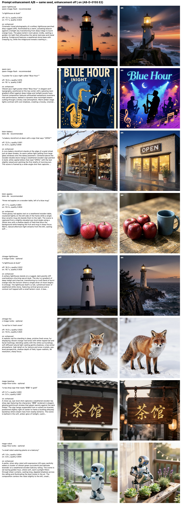

# Prompt enhancement A/B: each text-to-image profile, with and without the rewrite (AB-D-0155, E2)

**2026-10-19, Mac Studio (Mac17,14), M5 Max 128 GB, macOS 27.2.** The release build of the headless engine at E2
(uncommitted, on top of c36ea20), on mlx-image-runtime 0.13.0. It used two local branches, since released with the same
code:
- prompt-enhance-kit-swift `v0.5-profiles` (86b0d12), now v0.5.0 (729535d, the same tree);
- mlx-qwen-llm-swift `prompt-enhance-no-thinking` (d180a44), now v0.6.1 (the same commit).

The backbone was `qwen3.5-4b`, Qwen3.5-4B int4 (`mlx-community/Qwen3.5-4B-MLX-4bit`). The engine served on port 17620
from the shared models folder.

## Method

Every job went through the engine as a client sends it: `image.generate` with the model named, 1024², seed
20261019. Each case ran twice:
- **off:** `x-pixelagency.prompt_enhance {mode: off}`;
- **on:** `auto` for the recommended profiles (Qwen-Image, FLUX.2 [klein]), and `on` for the optional ones (Z-Image,
  Mage-Flow), whose `auto` leaves prompts alone.

Each output was then scored by the engine's `image.score`, SigLIP2 no-reference quality from 0 to 1. Prompt adherence
was judged by eye from the sheet.

The driver is [`prompt-enhance-ab/ab.py`](prompt-enhance-ab/ab.py), and [`sheet.swift`](prompt-enhance-ab/sheet.swift)
draws the sheet. Every job's record is in [`results.json`](prompt-enhance-ab/results.json); full-size PNGs are kept
locally in `bench/prompt-enhance-ab/`. Seconds are wall time per job, including any model swap: one heavy model is
resident at a time.

## Results

| Case | Model | Profile | Quality off → on | Read by eye |
|---|---|---|---|---|
| a lighthouse at dusk | qwen-image-flash | recommended | 0.924 → 0.924 | both good; on adds the coastline, surf and beam |
| a poster for a jazz night called "Blue Hour" | qwen-image-flash | recommended | 0.915 → 0.887 | **off renders a stray "INIGHT"**; on spells "Blue Hour" cleanly, busier composition |
| a bakery storefront at dawn with a sign that says "OPEN" | klein-4b | recommended | 0.901 → 0.909 | **off's sign reads "O PEN"**, small; on's is clean and prominent |
| three red apples on a wooden table, left of a blue mug | klein-4b | recommended | 0.883 → 0.904 | **off: two apples, mug on the wrong side**; on: apples left of the mug (right), but four of them |
| a lighthouse at dusk | z-image-turbo | optional | 0.922 → 0.929 | off is plain and foggy; on is a fuller dusk scene |
| a red fox in fresh snow | z-image-turbo | optional | 0.922 → 0.924 | about the same |
| a tea shop sign that reads "茶馆" in gold | mage-flow-turbo | optional | 0.893 → 0.897 | both render 茶馆; off adds small extra characters |
| a small robot watering plants on a balcony | mage-flow-turbo | optional | 0.894 → 0.904 | on is richer, golden hour |

- **Quality** rose or held in 7 of 8 cases, by up to +0.021 (klein apples). The jazz poster lost 0.028: the rewrite
  asked for a busier scene.
- **Prompt adherence:** the rewrite fixed rendered text twice (the jazz poster and the bakery sign) and a spatial
  relation once (the apples). It never broke a quoted string: "Blue Hour", "OPEN" and "茶馆" all came through
  verbatim.
- **Every "on" arm** reported `{applied: true, outcome: "enhanced"}` with the `prompt_rewritten` warning. Every "off"
  arm reported `outcome: "off"` and ran the prompt as typed.
- **Memory:** the backbone stayed warm through all 16 jobs beside each image model. Residency's only evictions were
  heavy image models swapping: Qwen-Image Flash, Klein and Mage-Flow Turbo.

## The headline case and reproducibility

"a lighthouse at dusk" on Qwen-Image Flash with seed 42, mode unset (so `auto`):
- 30.0 s cold, both models loading.
- `effective.model_params.prompt_enhancement` reported `applied: true`, outcome `enhanced`, profile `qwen-image` v1,
  backbone `qwen3.5-4b`, seed 42, and the 724-character rewrite ending with Qwen's suffix "Ultra HD, 4K, cinematic
  composition". The record is [`lighthouse-job.json`](prompt-enhance-ab/lighthouse-job.json).
- The same request again, with the backbone warm, gave **the same rewrite and byte-identical image bytes**. The
  enhancer's seed is the job's, so a fixed seed reproduces the job end to end.

## What the rewrites show about the profiles (for mlx-think)

- **klein:** the rewrite still ends with a negation ("No text, logos, or other people are present."), against the
  profile's instruction (as in AB-R-0588).
- **Qwen's English rewriter** adds quality tags ("8K resolution, photorealistic texture"), and the suffix repeats them.
  That's the vendor's text.
- **Z-Image's expander** answered the fox as a comma-separated tag list rather than prose, and the lighthouse with a
  "No text is present." negation.

## Live conformance

Run against the same engine after the A/B: 35 passed, 0 failed, 4 skipped, and Base 0.1 and Image 0.1 conform. The
report is [`conformance/2026-10-19-live.md`](conformance/2026-10-19-live.md).
